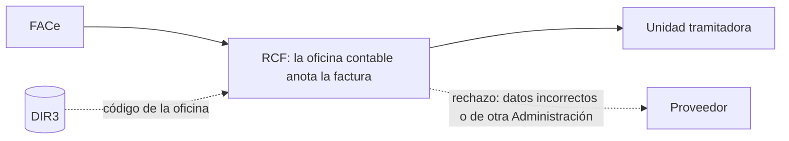

# Oficina contable

## Qué es
Es una de las tres unidades que toda factura electrónica dirigida a la Administración debe identificar con su código DIR3 (las otras dos son el órgano gestor y la unidad tramitadora). La oficina contable anota la factura en el registro contable de facturas (RCF) y se la pasa a la unidad tramitadora. Puede rechazarla si tiene datos incorrectos, si faltan datos que impiden tramitarla o si corresponde a otra Administración.

## Cómo se usa
- En el fichero Facturae, la oficina contable se indica en un nodo AdministrativeCentre con RoleTypeCode "01". Es obligatoria.
- El RCF descarga las facturas de FACe indicando el código DIR3 de sus oficinas contables.

## De qué sistemas depende
- DIR3: de ahí sale su código.
- FACe: la fuente de la que el RCF descarga las facturas.
- RCF: donde se anota la factura. En el ámbito de la IGAE, el RCF es un módulo de SIC'3.

## Cómo se crea
- Debe existir en DIR3 como oficina.
- El RCF mantiene una tabla que asocia cada oficina contable con su código DIR3.
- PENDIENTE DE VALIDAR: el procedimiento exacto de alta y quién lo gestiona en cada organismo.

## Qué preguntar al usuario (sugerencia, no procede de las fuentes)
- ¿Qué código DIR3 de oficina contable llevaba la factura?
- ¿Ese código existe en DIR3 y corresponde a la Administración destinataria?

## Diagrama

