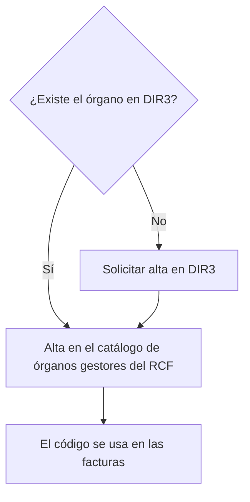

# Órgano gestor

## Qué es
Es la segunda de las tres unidades que debe identificar toda factura a la Administración. Según el resumen consultado (fuente secundaria), es el órgano que acepta o rechaza la factura. Su alcance concreto lo decide cada organismo.

## Cómo se usa
- En el fichero Facturae va en un nodo AdministrativeCentre con RoleTypeCode "02". Es obligatorio.
- Ejemplo de reparto en una universidad (guía de la Universidad de Jaén): el órgano gestor es la propia universidad, la unidad tramitadora es el departamento que hizo el pedido y la oficina contable es el servicio de contabilidad. En ese caso, los códigos del órgano gestor y de la oficina contable son siempre los mismos.

## De qué sistemas depende
- DIR3: su código sale de este directorio.
- RCF: el RCF mantiene un catálogo de órganos gestores, cada uno identificado con su código DIR3.

## Cómo se crea
- El órgano gestor debe estar dado de alta en el catálogo de órganos gestores del RCF.
- Para eso es imprescindible que antes esté dado de alta en DIR3. Si no lo está, se solicita su alta en DIR3.
- PENDIENTE DE VALIDAR: quién gestiona esto en cada organismo y cómo se comunican los datos al proveedor.

## Qué preguntar al usuario (sugerencia, no procede de las fuentes)
- ¿Qué código DIR3 de órgano gestor llevaba la factura?
- ¿Es el que el organismo le indicó para facturar?

## Diagrama

