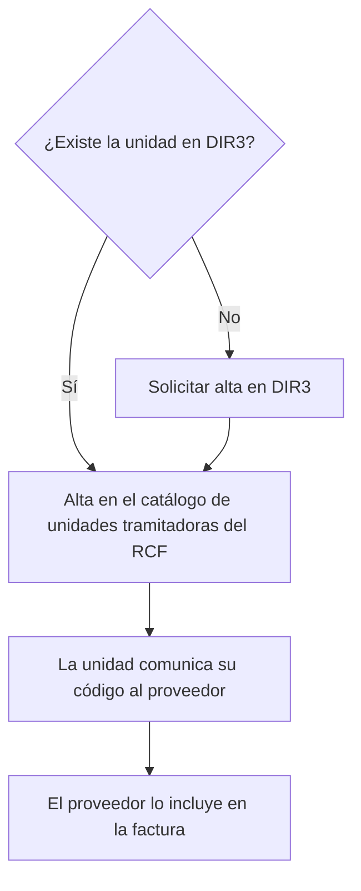

# Unidad tramitadora

## Qué es
Es una unidad administrativa del organismo destinatario de la factura. Recibe la factura de la oficina contable y anota en el registro contable de facturas (RCF) si se acepta o se rechaza. No es la empresa que emite la factura ni un simple código: el código DIR3 es lo que la identifica.

## Cómo se usa
- En el fichero Facturae va en un nodo AdministrativeCentre con RoleTypeCode "03". Es obligatoria.
- La unidad tramitadora es quien debe facilitar al proveedor su denominación y su código DIR3 para que figuren en la factura.
- Dentro de un mismo organismo suele variar de una factura a otra, porque depende de quién hizo el pedido, mientras que el órgano gestor y la oficina contable suelen ser fijos.

## De qué sistemas depende
- DIR3: de donde sale su código.
- RCF: mantiene un catálogo de unidades tramitadoras y, para cada una, a qué órganos gestores da servicio (con fecha de alta, de baja y un indicador de si está activa).
- Órgano gestor: cada unidad tramitadora está asociada a uno o varios.

## Cómo se crea
- Debe estar dada de alta en el catálogo de unidades tramitadoras del RCF.
- Para eso es imprescindible que antes esté dada de alta en DIR3; si no lo está, hay que solicitar su alta en ese directorio.
- En el ámbito de SIC'3 (IGAE), según una nota de 2013, el alta se hace desde Gestión de Unidades Tramitadoras > Alta Unidad Tramitadora Factura.
- La misma nota recomienda que las oficinas desglosen su estructura en DIR3: si no se dan de alta las unidades que necesitan, todas las facturas llegan a una sola de las áreas.
- PENDIENTE DE VALIDAR: el procedimiento vigente, porque la nota es de 2013, y cómo se hace en la AEAD.

## Qué preguntar al usuario (sugerencia, no procede de las fuentes)
- ¿Qué código DIR3 de unidad tramitadora llevaba la factura?
- ¿Se lo facilitó el propio organismo? ¿Está dado de alta y activo en DIR3 y en el RCF?

## Diagrama

