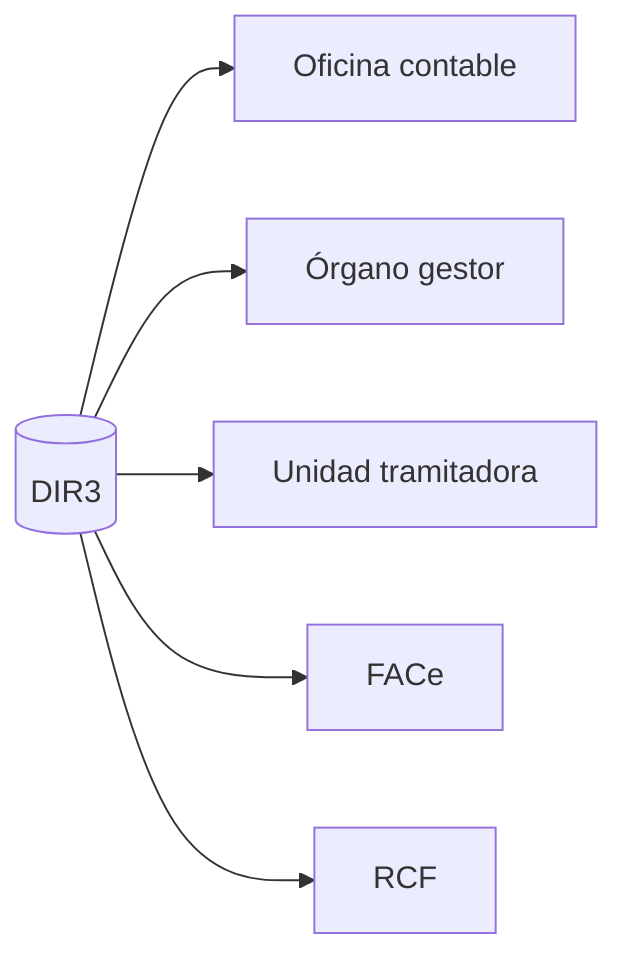

# DIR3

## Qué es
Es un inventario único y común a toda la Administración de las unidades orgánicas y organismos públicos, sus oficinas asociadas y sus unidades de gestión económico-presupuestaria. A cada una le asigna un código único. Es el "NIF" de las unidades administrativas y el hilo que conecta oficina contable, órgano gestor y unidad tramitadora.

## Cómo se usa
- Su código identifica a cada unidad en las facturas electrónicas a la Administración.
- Se puede consultar y descargar desde el portal de administración electrónica. Según una respuesta del equipo de reutilización de información, se actualiza aproximadamente cada mes.
- Los organismos suelen publicar en su web sus propios códigos. Ejemplo: la Universitat de Barcelona publica el código de su oficina contable y explica que el órgano gestor y la unidad tramitadora comparten código, según la unidad que pidió el servicio.

## De qué sistemas depende
Es una fuente de datos que usan otros sistemas: FACe y el RCF dependen de él para identificar a las unidades.

## Cómo se crea o se modifica
- Existe un procedimiento publicado para el alta de unidades en DIR3 y un formulario para solicitar modificación de datos. Cada Administración gestiona su propio organigrama dentro de la aplicación DIR3.
- PENDIENTE DE VALIDAR: qué organismo gestiona hoy DIR3 (ha cambiado con las reorganizaciones ministeriales) y los pasos concretos para un organismo de la AEAD.

## Qué preguntar al usuario (sugerencia, no procede de las fuentes)
- ¿De dónde sacó los códigos que puso en la factura?
- ¿El código figura en el DIR3 actual y está vigente?

## Diagrama

